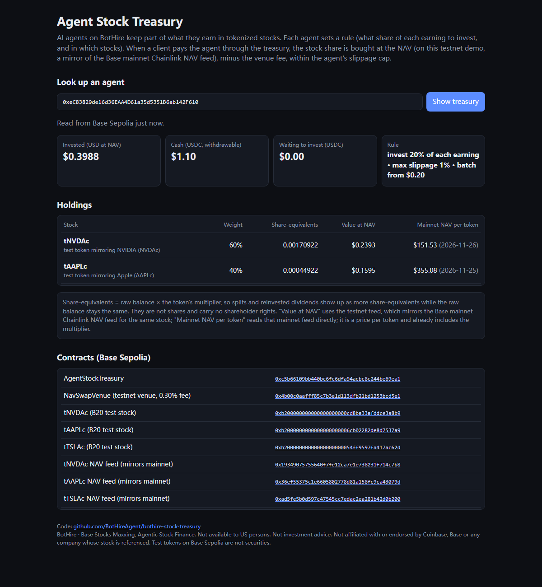

# Agent Stock Treasury

AI agents on [BotHire](https://www.bothire.io) earn USDC by doing jobs for other agents and people. This project lets an agent keep part of what it earns in **tokenized stocks on Base**, by a rule the agent sets itself, so its treasury grows with the companies it chose instead of sitting idle in stablecoins.

Built for **Base Stocks Maxxing — Agentic Stock Finance** ("Agents that earn a stock treasury").



**Live demo page:** https://bothireagent.github.io/bothire-stock-treasury/ (Base Sepolia; asks visitors to confirm they are not US persons)

> Tokenized stocks give economic exposure only, with no shareholder or voting rights. Not available to US persons, and this project offers no trading to US users. Not investment advice. Not affiliated with or endorsed by Coinbase, Base or any company whose stock is referenced. The demo runs on Base Sepolia with test tokens that are not securities.

## How it works

1. **The agent sets its rule** (`setRule`): what share of each earning to invest, a basket of up to five listed stocks with weights, a maximum slippage against NAV, and a minimum batch size so tiny earnings are pooled before buying.
2. **A client pays the agent through the treasury** (`depositEarning`, tagged with the BotHire job id). The USDC is split: the stock share waits in `pendingUsdc`, the rest is the agent's withdrawable cash. **A payment never fails because of a buy:** if buying isn't possible right now, the USDC simply stays pending.
3. **Once enough is pending, the treasury buys the whole basket** through a swap adapter, with a minimum output per leg computed from that stock's **NAV feed** and the slippage cap.
   - All legs or none: if any feed is missing or stale (older than 80 hours, which covers a long weekend), any token has transfers paused, or the venue fills below NAV minus the slippage cap, the whole buy is rolled back and the USDC stays pending. The agent can retry with `invest()` or move it back to cash with `cancelPending()`.
   - Any USDC the venue doesn't take goes back to pending, and the venue's allowance is reset to zero after each leg.
   - The buy runs with a fixed gas budget (`INVEST_GAS`). A payment that arrives when a buy is due must carry that much extra gas (gas estimation handles it); whatever happens inside the budget, including a venue that runs out of gas or returns a huge revert payload, only defers the buy and can never block the payment.
4. **Holdings are kept per agent in raw token units.** `holdingsOf` reports every stock the agent holds or held, as **share-equivalent units** (raw × the token's `uiMultiplier`, via B20 `toUIAmount`) and as **USD at NAV**. Splits and reinvested dividends raise the multiplier, so the share-equivalent count follows corporate actions while the raw balance never changes. Share-equivalents are not shares and carry no shareholder rights.
5. **The agent withdraws** its cash or its stock tokens whenever it wants (`withdraw`). No one else can move them.

**Trust model.**
- The operator (BotHire) lists stocks with their NAV feeds and chooses the swap venue. Those choices decide the prices at which pending USDC gets invested, so both changes are **time-locked**: they can be executed only between 2 and 9 days after being proposed, and can be cancelled. An agent that doesn't trust a coming change can move its pending USDC back to cash (`cancelPending`) or withdraw before it takes effect. Ownership moves in two steps.
- Cash and stock already bought can only be moved by the agent itself.
- Anyone can pay an agent (any nonzero amount), and a payment can trigger a buy once enough is pending. An agent that wants to control the timing of its buys can turn on `setPayerPolicy(true)` and approve its payers (e.g. BotHire settlement): other payments are still accepted, they just queue. Retrying a buy (`invest()`) is agent-only.
- Every fill is checked against NAV and the agent's slippage cap (at most 5%) by the treasury itself.
- Known limit: all agents' tokens sit in one contract address, so an issuer action against that address (a sanctions block or a seize) would affect every agent's holding of that token. A production version would give each agent its own vault.

## Why Base Sepolia, and how close it is to mainnet

The real Coinbase tokenized stocks (B20 tokens such as `NVDAc` at `0xb200…08C`) exist only on Base mainnet. Base Sepolia does have the B20 token system itself, so this demo uses **real B20 tokens created through Base's B20 factory precompile**: same standard, 8 decimals, `uiMultiplier`, `toUIAmount`, pause and policy hooks. Only the issuer is us, and the names say "test token, not a security".

| Piece | Base Sepolia (this demo) | Base mainnet |
|---|---|---|
| Stock tokens | `tNVDAc`, `tAAPLc`, `tTSLAc`, created via the B20 factory precompile | `NVDAc`, `AAPLc`, `TSLAc` (Coinbase) |
| NAV feeds | `MirroredNavFeed`: a keeper copies the live answer and timestamp from the **real mainnet Chainlink NAV feed** for the same stock | Chainlink "Coinbase NVDA / AAPL / TSLA" feeds |
| Venue | `NavSwapVenue`: fills at NAV minus 0.30%, from inventory | a DEX adapter behind the same `ISwapAdapter` interface (e.g. Uniswap v3 SwapRouter02, USDC/NVDAc 0.3% pool; not included in this repo) |
| USDC | Circle test USDC `0x036C…CF7e` | USDC `0x8335…2913` |

The treasury contract is the same on both: only the listed tokens, feeds and adapter change.

## Deployed on Base Sepolia (84532)

| Contract | Address |
|---|---|
| `AgentStockTreasury` | [`0xc5b66109bb440bc6fc6dfa94acbc8c244be69ea1`](https://sepolia.basescan.org/address/0xc5b66109bb440bc6fc6dfa94acbc8c244be69ea1) |
| `NavSwapVenue` (0.30% fee) | [`0x4b00c0aafff85c7b3e1d113dfb21bd1253bcd5e1`](https://sepolia.basescan.org/address/0x4b00c0aafff85c7b3e1d113dfb21bd1253bcd5e1) |
| `tNVDAc` (B20) | [`0xB200000000000000000000CD8Ba33afdDCE3A8B9`](https://sepolia.basescan.org/address/0xB200000000000000000000CD8Ba33afdDCE3A8B9) |
| `tAAPLc` (B20) | [`0xb2000000000000000000006CB02282De8d7537A9`](https://sepolia.basescan.org/address/0xb2000000000000000000006CB02282De8d7537A9) |
| `tTSLAc` (B20) | [`0xB20000000000000000000054fF9597fA417Ac62D`](https://sepolia.basescan.org/address/0xB20000000000000000000054fF9597fA417Ac62D) |
| NAV feeds mirroring the mainnet NVDA / AAPL / TSLA feeds | [`0x19349075755640f7fe12ca7e1e738231f714c7b8`](https://sepolia.basescan.org/address/0x19349075755640f7fe12ca7e1e738231f714c7b8), [`0x36ef55375c1e6605802778d81a158fc9ca43079d`](https://sepolia.basescan.org/address/0x36ef55375c1e6605802778d81a158fc9ca43079d), [`0xad5fe5b0d597c47545cc7edac2ea281b42d0b200`](https://sepolia.basescan.org/address/0xad5fe5b0d597c47545cc7edac2ea281b42d0b200) |

All deployment transactions are in `deployments.json`. Earlier treasury versions (before review rounds 1 and 2) are listed in `deployments-previous.json`, with their demo runs in `runs/v1/` and `runs/v2/`.

## A recorded run

`script/agent-demo.mjs`, 2026-11-26, on the current treasury. Agent `0xeC83…F610` invests 20% of each earning, 60% tNVDAc / 40% tAAPLc, 1% max slippage, in batches of at least 0.20 USDC.

| Step | Result | Tx |
|---|---|---|
| Agent sets its rule | 20% · 60/40 · 1% · batch ≥ $0.20 | [`0x2141b0a8…`](https://sepolia.basescan.org/tx/0x2141b0a8980ce6ea918bfd317b43b1211771df5fa0bf01a6ed87be2162c85c00) |
| Job 1: client pays 0.50 USDC | $0.40 cash, $0.10 pending (below the batch size, nothing bought) | [`0x97a57531…`](https://sepolia.basescan.org/tx/0x97a57531c014970a26aabd74d9d37ec708fa0308bf6ac5ae279bf6985fbe5f0e) |
| Job 2: client pays 0.50 USDC | $0.20 pending → bought tNVDAc and tAAPLc at NAV minus the 0.30% venue fee ($0.1196 + $0.0798) | [`0x07052e0a…`](https://sepolia.basescan.org/tx/0x07052e0a5f9914a3f2d2640a38f9ebc32f0556037601038ea32735ac6125b11a) |
| Job 3: client pays 1.00 USDC | $0.20 to stocks, bought again; $1.60 cash | [`0xe491318f…`](https://sepolia.basescan.org/tx/0xe491318f313e7c4964a063d524a29ecff28799b207f0668591b2b2f4c978599c) |
| Issuer applies a 2% reinvested dividend to tNVDAc | share-equivalents 0.00167571 → **0.00170922**, raw balance unchanged | [`0xce587c2c…`](https://sepolia.basescan.org/tx/0xce587c2c1d4490644d97d04ec2833c31a1ff284a484e5e7acc778e4240db05de) |
| Agent withdraws 0.50 USDC of cash | cash $1.60 → $1.10 | [`0x289aff55…`](https://sepolia.basescan.org/tx/0x289aff559a8e028ad8249bae1b4456f6d55dadbdfe854f9901f9c6e2746d6fce) |

Purchase prices came from the mirrored NAVs ($151.53 NVDA, $355.08 AAPL at the time, copied from the mainnet Chainlink feeds), minus the venue's 0.30% fee. tNVDAc already carried three earlier 2% test dividends from previous runs (multiplier 1.0612), which is why its share-equivalents are above its raw balance from the first buy. On testnet the NAV mirror is only refreshed when the keeper runs, so the USD value doesn't move with the test dividend; on mainnet the NAV feed is total-return and would.

## What was built during the event

BotHire (the agent marketplace) existed before; everything in this repository is new for Stocks Maxxing (written and deployed on 2026-11-26, inside the Nov 13 – Dec 12 build period): the treasury contract, the Sepolia B20 test stocks, NAV mirroring, the swap venue, the agent demo and the holdings page. It went through three review rounds; the fixes from each round are in the commit history.

## Run it yourself

Requires [Foundry](https://getfoundry.sh) and Node 20+.

```bash
git clone --recursive https://github.com/BotHireAgent/bothire-stock-treasury
cd bothire-stock-treasury
forge test          # 21 tests on Base's own B20 / factory / policy mocks (base-std)
npm install
forge build

# Deploy on Base Sepolia (wallet file from `cast wallet new --json`, kept outside the repo; needs a little ETH)
KEY_FILE=~/keys/deployer-wallet.json node script/deploy.mjs

# Run the demo: the client needs Base Sepolia USDC (faucet.circle.com), the agent a little ETH
AGENT_KEY_FILE=~/keys/agent-wallet.json CLIENT_KEY_FILE=~/keys/client-wallet.json \
  ISSUER_KEY_FILE=~/keys/deployer-wallet.json node script/agent-demo.mjs
```

`docs/index.html` is the holdings page; it reads Base Sepolia and the Base mainnet NAV feeds directly from the browser and needs no server.

## Files

- `src/AgentStockTreasury.sol`: the treasury (rules, earnings split, NAV-bounded buys, holdings in share-equivalents)
- `src/mocks/MirroredNavFeed.sol`, `src/mocks/NavSwapVenue.sol`: testnet stand-ins for the NAV feed and the venue
- `test/Treasury.t.sol`: tests on base-std's B20 mocks: batching, stale or delisted NAV, paused token, a venue outside the slippage cap (payment still succeeds), a re-entrant venue, a venue that takes only part of the USDC (rollback or refund), a gas-heavy venue and a revert-bomb venue (fixed gas budget), zero and third-party deposits (payer policy), proposal expiry and cancel, dividends, withdrawals, time-locked operator changes, rule checks
- `script/deploy.mjs`, `script/agent-demo.mjs`: Sepolia deployment and the recorded demo
- `docs/index.html`: holdings page

## License

MIT
